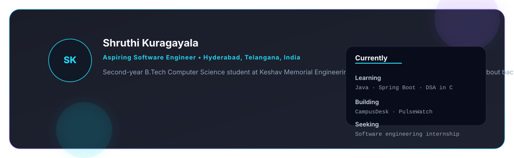
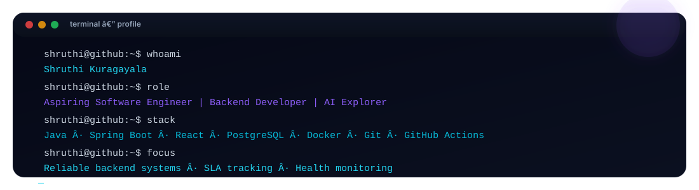
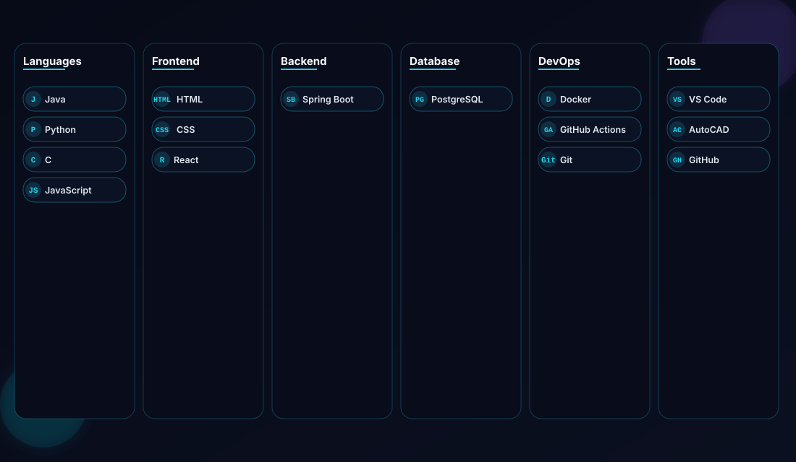
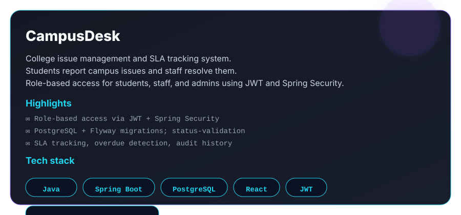
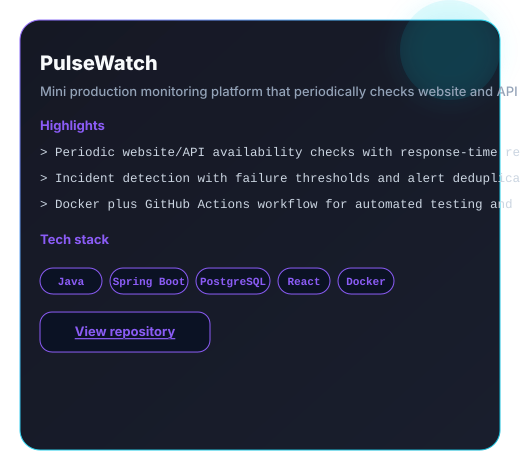
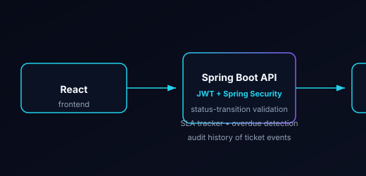
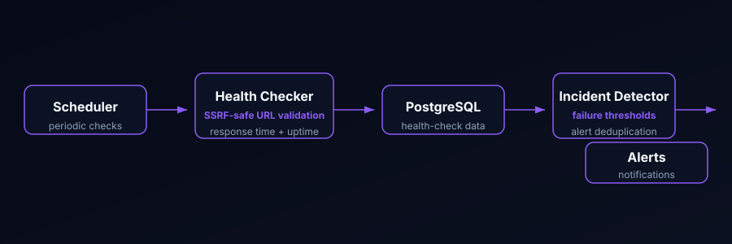
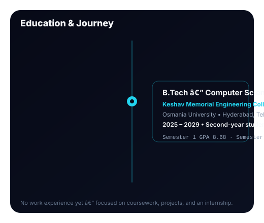
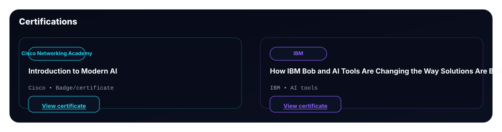

  <picture>
    <source media="(prefers-color-scheme: dark)" src="assets/hero.svg" width="100%" alt="Animated hero banner with name Shruthi Kuragayala, rotating role lines, and an Open to internships status chip"/>
    
  </picture>

  
  
  

  <picture>
    <source media="(prefers-color-scheme: dark)" src="assets/about.svg" width="100%" alt="About card with bio and a Currently panel showing Learning, Building, Seeking"/>
    
  </picture>

  <picture>
    <source media="(prefers-color-scheme: dark)" src="assets/terminal.svg" width="100%" alt="Animated terminal card showing whoami, role, stack, and focus lines typing in sequence"/>
    
  </picture>

  <picture>
    <source media="(prefers-color-scheme: dark)" src="assets/stack.svg" width="100%" alt="Tech stack bento grid categorized into Languages, Frontend, Backend, Database, DevOps, and Tools"/>
    
  </picture>

  
<strong>Full skill list</strong>

   
  <b>Languages:</b> Java, Python, C, JavaScript 
  <b>Frontend:</b> HTML, CSS, React 
  <b>Backend:</b> Spring Boot 
  <b>Database:</b> PostgreSQL 
  <b>DevOps:</b> Docker, GitHub Actions, Git 
  <b>Tools:</b> VS Code, AutoCAD, GitHub 
  <b>Other:</b> Data Structures and Algorithms with C

## Featured Projects

  <table>
    <tr>
      <td>
        <picture>
          <source media="(prefers-color-scheme: dark)" src="assets/campusdesk.svg" width="100%" alt="CampusDesk project card"/>
          
        </picture>
      </td>
      <td>
        <picture>
          <source media="(prefers-color-scheme: dark)" src="assets/pulsewatch.svg" width="100%" alt="PulseWatch project card"/>
          
        </picture>
      </td>
    </tr>
  </table>

### Architecture

  <table>
    <tr>
      <td>
        <picture>
          <source media="(prefers-color-scheme: dark)" src="assets/campusdesk-arch.svg" width="100%" alt="CampusDesk architecture: React to Spring Boot API to PostgreSQL"/>
          
        </picture>
      </td>
      <td>
        <picture>
          <source media="(prefers-color-scheme: dark)" src="assets/pulsewatch-arch.svg" width="100%" alt="PulseWatch architecture: scheduler to health checker to PostgreSQL to incident detector to alerts"/>
          
        </picture>
      </td>
    </tr>
  </table>

## GitHub Stats

  <table>
    <tr>
      <td>
        
      </td>
      <td>
        
      </td>
    </tr>
    <tr>
      <td>
        
      </td>
    </tr>
  </table>

  

  <picture>
    <source media="(prefers-color-scheme: dark)" src="assets/education.svg" width="100%" alt="Education timeline card for KMEC with GPAs"/>
    
  </picture>

  <picture>
    <source media="(prefers-color-scheme: dark)" src="assets/certifications.svg" width="100%" alt="Certifications card: Cisco Introduction to Modern AI and IBM AI tools"/>
    
  </picture>

  <picture>
    <source media="(prefers-color-scheme: dark)" src="assets/footer.svg" width="100%" alt="Animated gradient footer banner with tagline"/>
    
  </picture>

  

